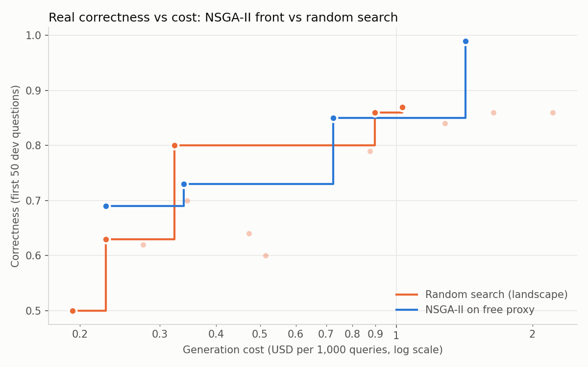
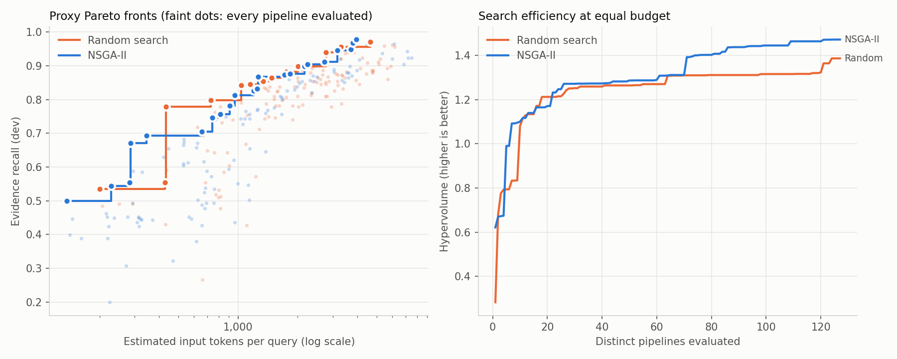

# evo-rag

**Evolutionary optimization of RAG pipelines for the EU AI Act.**

A retrieval-augmented question-answering system over the EU AI Act whose design (chunking, retrieval,
embedding model, context size, query planning) is searched with multi-objective evolutionary
algorithms, trading answer quality against cost. The whole project, including every experiment,
cost about **€3.75** in API calls.

**[▶ Live demo: compare the pipelines' answers](https://zmcs.github.io/evo-rag/)**: all 75 test questions, each pipeline's answer next to the verified reference answer, plus how the project was built.

## Results

Held-out test set: 75 questions never used during development.

| Pipeline | Correctness (strict) | Correctness (reviewed) | Multi-hop | Cost / 1k queries |
|---|---|---|---|---|
| Baseline: dense retrieval, k=5 | 0.780 | 0.780 | 0.27 | $0.36 |
| Cheap: LoRA-adapted embedder, k=5 | 0.800 | 0.827 | 0.32 | $0.36 |
| **Best: hybrid retrieval, k=13, query planning** | **0.913** | **0.953** | **0.82** | $1.48 |

- **Correctness 0.78 → 0.91–0.95** on unseen questions, driven by multi-hop questions (0.27 → 0.82).
- **Faithfulness 0.99** for all three: answers stay grounded in the retrieved text.
- *Strict* scoring requires the exact abstention sentence on unanswerable questions. On manual review,
  every "answered an unanswerable question" case correctly said the Act does not specify the item
  (e.g. *"no minimum accuracy percentage; Article 15 requires an appropriate level…"*), hence the
  *reviewed* column. Both are reported because the issue was found after the test run.


*Real correctness vs cost on 50 dev questions: final system (blue) vs the initial random-search baseline (orange).*

## How it works

```
question ──► [query planner] ──► retrieval ──► top-k chunks ──► generator ──► answer
               (optional LLM)    dense / BM25 /                  Gemini 3.5
                                 hybrid, embedder                Flash-Lite
                                         ▲
                        every choice is a gene in PipelineConfig
                                         │
           NSGA-II searches the genes, maximising quality and minimising cost
```

- **Corpus:** the AI Act split into 113 articles and 13 annexes.
- **QA set:** 253 questions (single-hop, multi-hop, numerical, unanswerable), each with a verbatim
  evidence quote, split 70/30 into dev and test. Drafted by an LLM, quote-validated automatically,
  verified by hand.
- **Evaluation:** an LLM judge scores correctness against the gold answer and faithfulness against the
  retrieved context. Run-to-run noise is ±0.006; sampling uncertainty is ±0.03 on the full dev set.
- **Search space:** chunker, chunk size and overlap, article headers, embedder, retrieval method, hybrid
  weight, `top_k`, and query planning on or off.

## Key findings

**1. A free proxy makes evolution affordable, but the first proxy was gamed.** Running every candidate
through the LLM was too expensive, so NSGA-II optimized retrieval recall (free to compute) and
estimated tokens. The first run exploited a loophole: tiny 200-character chunks retrieved fragments of
the right article without the answer (article recall 0.88, but only 0.48 of answer passages found).
A stricter proxy, *evidence recall* (is the answer quote itself retrieved?), closed it and predicted
real correctness with a rank correlation of **0.95**.


*Proxy Pareto fronts and hypervolume at equal budget.*

**2. NSGA-II beats random search and learns design rules on its own.** At equal budget (127 pipelines)
NSGA-II reached **+6% hypervolume**. Given the option of LLM query planning, it used planning only
for pipelines with enough context (k ≥ 4), never at the cheap end: the same rule found by hand.

**3. The bottleneck moved from retrieval to the generator.** Query planning fixed questions whose answer
lives in a separate article, such as fines in Art. 99 and dates in Art. 113 (numerical 0.83 → 0.95 on dev).
Multi-hop answers still failed, and a diagnosis showed every failure was a *refusal with all evidence
present*. A prompt telling the model to follow references between provisions raised multi-hop
from 0.78 to 0.89 on dev.

**4. Fine-tuning the embedder: capacity matters more than the optimizer.** Four ways of adapting
bge-small to the AI Act, trained on synthetic question–passage pairs (never on the QA set):

| Method | Parameters | Optimizer | Evidence recall (dev, dense k=5) |
|---|---|---|---|
| none | – | – | 0.775 |
| diagonal adapter | 384 | gradient descent | 0.791 |
| diagonal adapter | 384 | **CMA-ES** (optimizes the ranking metric directly) | 0.772 |
| linear adapter | 147k | gradient descent | **0.854** |
| LoRA | 147k | gradient descent | **0.854** |

At equal capacity, CMA-ES and gradient descent tie; more capacity is what helps. Inside the best
pipeline, all embedders reach about 0.98 evidence recall, so fine-tuning helps cheap pipelines, not the top.

## Reproducing

Requires Python 3.10+, [uv](https://github.com/astral-sh/uv) and a Gemini API key.

```bash
uv sync
echo "GEMINI_API_KEY=..." >> .env
echo "EVO_RAG_BUDGET_USD=4.8" >> .env     # hard spending limit enforced by the code
```

| Step | Command | API cost |
|---|---|---|
| Build the corpus (needs the AI Act PDF in `data/raw/`) | `python -m evo_rag.corpus` | – |
| Validate the QA set | `python -m evo_rag.qa` | – |
| Retrieval-only comparison | `python -m evo_rag.retrieval_eval` | – |
| Evaluate one pipeline | `python -m evo_rag.evaluate --n 50` | ~$0.04 |
| Random-search landscape | `python -m evo_rag.landscape --yes` | ~$1.60 |
| NSGA-II on the free proxy | `python -m evo_rag.evolve --objective evidence_recall` | – |
| Validate the front | `python -m evo_rag.validate_front --prompt combine --yes` | ~$0.25 |
| Query planning check | `python -m evo_rag.decompose_check --plan --eval` | ~$0.20 |
| Embedder adaptation | `python -m evo_rag.synth_data --yes` then `adapt`, `adapt_check` | ~$0.07 |
| Final test evaluation | `python -m evo_rag.final_eval --test --yes` | ~$0.30 |

Every paid script runs as a dry run with a cost estimate unless given `--yes`, and all LLM calls are
cached, so re-running is free.

## Project structure

```
src/evo_rag/
  config.py           PipelineConfig: the genome
  corpus.py, qa.py    corpus building and QA validation
  chunking.py         fixed, recursive and semantic chunkers
  retrieval.py        dense, BM25 and hybrid retrieval; cached indexes; adapted embedders
  planner.py          LLM query planning and merged retrieval
  generation.py       prompt templates
  llm.py              Gemini wrapper: caching, cost tracking, budget guard
  judge.py            correctness and faithfulness judge
  evaluate.py         the fitness function
  proxy.py            free proxy objectives (recall, evidence recall, tokens)
  search_space.py     genes and their encoding for pymoo
  evolve.py           NSGA-II vs random search
  adapt.py            diagonal, linear, CMA-ES and LoRA embedder adaptation
  final_eval.py       the frozen pipelines on the test set
data/processed/       corpus.jsonl, qa.jsonl, synthetic_pairs.jsonl
data/results/         every evaluation, logged with its config and QA version
```

## Limitations and future work

- **Small evaluation sets.** 75 test questions give ±0.06–0.09 confidence intervals; hypervolume
  comparisons use single seeds.
- **Dev-set optimism.** The prompt design was informed by dev failures (0.99 on dev vs 0.91–0.95 on test).
- **LLM judge.** Agreement with human labels was 100% on clear-cut answers, but borderline multi-hop
  cases may be judged leniently. Unanswerable questions are scored by an exact-phrase rule; judging them
  with the LLM would remove the strict/reviewed distinction.
- **Not explored:** an LLM as mutation operator inside the evolutionary loop, prompt-optimizer baselines
  such as DSPy, and the amended AI Act text (Regulation (EU) 2026/1744) as a corpus-drift test.

## Corpus

Regulation (EU) 2024/1689 as published in OJ L, 12.7.2024. Later amendments, including Regulation (EU)
2026/1744, are not included. QA pairs were drafted by an LLM, quote-validated automatically, and verified
by hand.
